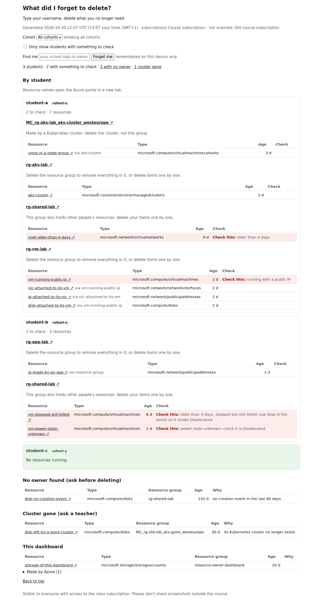

# Azure resource owner dashboard

A page for everyone in a shared Azure course subscription, mostly students: **what did I forget
to delete?** Type your username, delete what you no longer need. Each student has a card with
their resources, grouped by resource group: name, type and age. Each group has a help line that
says whether the whole group can go or only your own items, because others have resources in
it too. A **Check this** mark, on a tinted row, sits on anything older than 4 days, on a running
VM with a public IP, on a VM that is stopped but still billed (only Deallocated stops the
compute charge), and on a VM whose power state could not be read. A disk attached to a VM, a
network interface on an existing VM and a public IP on such a network interface are never
marked; the VM's own marks cover them. Resources with no known owner, what Azure made by
itself and the dashboard's own resource group are listed at the bottom, never on a card.
Teachers use the same page to see who to talk to. Students see each other's resources (the
teachers agreed). Type your username into **Find me** to see only your own; the page remembers
it on your device until you press **Forget me**. A red banner warns when the page is more than
26 hours old.



The deployed page is rebuilt at 06:00 and 16:00 UTC by an Azure Function and served behind the
school sign-in, to people who hold a role on the class subscription. How it works, step by step,
and what each part of the page means: [docs/FAQ.md](docs/FAQ.md).

## What's in the repo

- `src/dashboard/`: the Python code that scans, finds owners and cohorts, and renders the page.
  The same code runs as a local CLI (`python -m dashboard`) and as the Azure Function.
- `function_app.py` and `host.json`: the Function's entry point (the `scan` timer and the `page`
  HTTP function) and its host settings.
- `requirements.txt`: the Function's dependencies, pinned with hashes (see Function bundle).
- `infra/`: the Bicep for the running dashboard: the resource group, identities, storage,
  monitoring, the Flex Consumption function app, its alerts, and Reader for the scan identity on
  each scanned subscription.
- `settings.json`: the 4-day age limit, the 90-day Activity Log lookback and the name of the
  dashboard's own resource group.
- `docs/FAQ.md`: how the dashboard works, and the questions students ask.
- `scripts/`: build the Function package, regenerate `requirements.txt`, summarise what-if and
  deployment output with nothing private in it, the smoke test, and the local check that blocks
  commits holding private terms (`.denylist`).
- `tests/`: pytest, no Azure access needed.

## Run it locally

The demo needs only Python 3.14:

```bash
python3.14 -m venv .venv && . .venv/bin/activate
pip install -e '.[dev]' && pre-commit install
python -m dashboard demo    # fake data, no Azure: writes out-demo/index.html
```

To scan the real subscription you also need the Azure CLI and access to the subscription. Run
these from the repo root:

```bash
az login
cp dashboard.example.toml dashboard.toml   # optional: the roster path, never commit
cp roster.example.csv roster.csv           # optional: usernames and cohorts, never commit
python -m dashboard scan
```

Cohorts come only from the roster; without one, every card shows "no cohort". If your login is
missing or expired, the scan stops before it starts and asks you to run `az login`.

The scan writes `out/index.html` and `out/verify.md`. Never commit `out/`, and delete it after
each use: it holds live data.

Never set a DEBUG log level: the Azure SDK would log request headers and the signed-in account.

### Read-only

The dashboard changes nothing in the class's Azure resources, and the code guarantees it, not
a role. Every Azure client sends its requests through a transport that refuses everything but
GET requests and the Resource Graph query, so a write fails before it leaves your machine or
the Function. An offline test (`tests/test_clients.py`) proves that a write is refused. A local
scan runs with your own login, which may be Owner on the subscription; Azure roles add up, so
no role could keep it read-only, and the transport does. The deployed scan runs as its own
identity, which holds Reader on each scanned subscription.

The scan writes one thing: `site/index.html` in its own storage account, through a second guard
that allows exactly one request, a `PUT` of that blob with no query string, and nothing else.
`tests/test_read_only.py` proves that no other write exists in `src/` or `function_app.py`.

## Tests

`pytest` runs the tests without Azure access. `tests/test_infra.py` compiles the Bicep and checks
the security settings and the exact role set offline, so it needs the Bicep CLI; it skips
without it locally, and CI sets `REQUIRE_BICEP=1` so that it cannot skip there.
`pre-commit run --all-files --hook-stage manual` also runs the hook kept out of each commit
(pre-commit's "manual" stage): a gitleaks scan of the whole git history. CI runs both on every
pull request and every push to `main`.

## Deploy (the maintainer, locally)

There is no CI deploy: a maintainer deploys from their own machine with their own login. GitHub
never has Azure access. Deploying needs Owner (or Contributor plus User Access Administrator) on
the dashboard's subscription and on each scanned one, because `infra/reader.bicep` writes role
assignments there. Everything is Bicep, sources in the comments of `infra/`.

**Once:**
```bash
# Bicep CLI on PATH (0.48.1 when this was written; the templates use roleDefinitions(),
# new in 0.42.1): https://learn.microsoft.com/en-us/azure/azure-resource-manager/bicep/install
az config set bicep.use_binary_from_path=True    # az deployment then uses that same binary
az login
az account set --subscription "<class subscription name or ID>"
cp infra/main.example.bicepparam infra/main.bicepparam   # fill in, never commit
install -d -m 700 out/deploy
```
In `infra/main.bicepparam` set `location` (a region), `scanSubscriptionIds` (the class
subscription's ID, plus any other the scan should read), and `alertEmail` (empty sends no
email). Keep `scheduleEnabled = false` and `authClientId = ''` for the first two phases.

The deployment goes up in three phases, in this order, because the sign-in registration needs the
app's hostname, which exists only after phase 1, and code goes up only once sign-in is on.
Every command runs from the repo root, with the activated venv for `python`.

**How the blocks behave.** Paste a block into your shell. A pasted block does not stop at a
failed line (an `exit` would close your terminal), so every use of a value captured in an earlier
step is written `"${NAME:?}"`: bash then refuses that one command, naming the variable and never
its value, when the value is empty or unset, so no command ever runs with an empty value. If a
command reports an error, stop pasting and look at the error codes (below) before going on. The
variables come from the outputs block of phase 1: in a new terminal, run that block again first.

### Phase 1: the infrastructure

From a clean checkout of `main`:
```bash
az deployment sub what-if --name resource-owner-dashboard --location <region> \
  --parameters infra/main.bicepparam --no-pretty-print -o json \
  > out/deploy/whatif.json 2>> out/deploy/errors.log
python scripts/deploy_summary.py out/deploy/whatif.json     # masked; read the file yourself too
```
The first time, the summary has `Create` lines only and no `DELETE`. Review it (and
`out/deploy/whatif.json`), then create:
```bash
az deployment sub create --name resource-owner-dashboard --location <region> \
  --parameters infra/main.bicepparam -o json \
  > out/deploy/deploy.json 2>> out/deploy/errors.log
python scripts/deploy_summary.py out/deploy/deploy.json     # "provisioningState: Succeeded"
```
(`--parameters` takes the `.bicepparam` alone: its `using` line names the template, and adding
`--template-file` is an error,
[Bicep parameters files](https://learn.microsoft.com/en-us/azure/azure-resource-manager/bicep/deploy-cli#bicep-parameters-files).
Syntax of both commands: [az deployment sub](https://learn.microsoft.com/en-us/cli/azure/deployment/sub).)

Azure writes errors to stderr, with IDs and sign-in names, so they go to `out/deploy/errors.log`
and are never printed or pasted. To see what failed, list only the error codes:
```bash
grep -oE '\(Code: [A-Za-z0-9.]+\)|^Code: [A-Za-z0-9.]+|^ERROR: \([A-Za-z0-9.]+\)' \
  out/deploy/errors.log | sort | uniq -c
```
If a create fails part-way, keep the files, summarise the deployment as it stands, then run the
what-if again and review the new plan before retrying:
```bash
az deployment sub show --name resource-owner-dashboard -o json > out/deploy/deploy.json
python scripts/deploy_summary.py out/deploy/deploy.json
```

Read the deployment's outputs into shell variables (they are IDs and names: never print them):
```bash
out() { az deployment sub show --name resource-owner-dashboard \
  --query "properties.outputs.$1.value" -o tsv; }
RG=$(out resourceGroupName); APP=$(out functionAppName); HOST=$(out defaultHostName)
SCAN_PRINCIPAL=$(out scanPrincipalId); AUTH_PRINCIPAL=$(out authPrincipalId)
DATA_ACCOUNT=$(out dataAccountName); WORKSPACE_ID=$(out workspaceCustomerId)
SUB_ID=$(az account show --query id -o tsv); TENANT_ID=$(az account show --query tenantId -o tsv)
: "${RG:?}" "${APP:?}" "${HOST:?}" "${SCAN_PRINCIPAL:?}" "${AUTH_PRINCIPAL:?}" \
  "${DATA_ACCOUNT:?}" "${WORKSPACE_ID:?}" "${SUB_ID:?}" "${TENANT_ID:?}"   # names an empty one
```

With an alert email set, confirm the one-time passcode email from Azure within 30 minutes of
the create ([action groups](https://learn.microsoft.com/en-us/azure/azure-monitor/alerts/action-groups):
"Email addresses must be verified through a one-time passcode (OTP) within 30 minutes of saving
the action group"). The address is readable by every Owner of the subscription (on the action
group and in the deployment history), so a role or alias mailbox is a better choice than a
personal one.

### Phase 2: the app registration and sign-in

The registration is one Microsoft Entra app, single tenant, with no secret: the `auth` identity
signs the sign-in client assertion through a federated credential
([az ad app](https://learn.microsoft.com/en-us/cli/azure/ad/app),
[Entra provider](https://learn.microsoft.com/en-us/azure/app-service/configure-authentication-provider-aad)).
```bash
# Creates the registration only if none of that name exists yet.
APP_ID=
[ "$(az ad app list --display-name resource-owner-dashboard --query 'length(@)' -o tsv)" = "0" ] \
  && APP_ID=$(az ad app create --display-name resource-owner-dashboard \
    --sign-in-audience AzureADMyOrg \
    --web-redirect-uris "https://${HOST:?}/.auth/login/aad/callback" \
    --enable-id-token-issuance true --enable-access-token-issuance false --query appId -o tsv)
: "${APP_ID:?}"
APP_OBJECT_ID=$(az ad app show --id "${APP_ID:?}" --query id -o tsv)
: "${APP_OBJECT_ID:?}"
cat > out/deploy/fic.json <<EOF
{
  "name": "resource-owner-dashboard-auth",
  "issuer": "https://login.microsoftonline.com/${TENANT_ID:?}/v2.0",
  "subject": "${AUTH_PRINCIPAL:?}",
  "description": "Sign-in client assertion from the dashboard's auth identity",
  "audiences": ["api://AzureADTokenExchange"]
}
EOF
az ad app federated-credential create --id "${APP_OBJECT_ID:?}" --parameters out/deploy/fic.json
```
Check the registration before going on: `az ad app owner list --id "${APP_ID:?}" --query 'length(@)'`
prints 1 or more (you must own it), `az ad app federated-credential list --id "${APP_OBJECT_ID:?}"
--query 'length(@)'` prints 1, and `az ad app credential list --id "${APP_ID:?}" --query 'length(@)'`
prints 0 (no secret). `APP_ID` and `APP_OBJECT_ID` are not deployment outputs; in a new terminal,
read the client ID again with `az ad app list --display-name resource-owner-dashboard --query
'[0].appId' -o tsv`. Then put the client ID in `authClientId` in `infra/main.bicepparam`,
run the what-if and create again as in phase 1 (new file names, `whatif-2.json` and
`deploy-2.json`). The summary must now show `Create Microsoft.Web/sites/config x1` and no
`DELETE`; any `Modify` line is worth reading in the file.

Then check that no secret exists anywhere (each count should be as shown), and that the
sign-in settings are on:
```bash
az functionapp config appsettings list --name "${APP:?}" --resource-group "${RG:?}" --query "[].name" -o tsv \
  | grep -cxE 'AzureWebJobsStorage|MICROSOFT_PROVIDER_AUTHENTICATION_SECRET'      # 0
az functionapp config appsettings list --name "${APP:?}" --resource-group "${RG:?}" --query "[].name" -o tsv \
  | grep -cx OVERRIDE_USE_MI_FIC_ASSERTION_CLIENTID                                # 1
az ad app credential list --id "${APP_ID:?}" --query 'length(@)'                    # 0 passwords
az ad app credential list --id "${APP_ID:?}" --cert --query 'length(@)'             # 0 certificates
```
The smoke test below checks the other half: an unsigned request is refused, and a browser's
request is sent to the school sign-in. The redirect needs a browser-like `User-Agent` as well as
`Accept: text/html`; without them the answer is 401.

### Phase 3: the code

```bash
python scripts/build_function.py     # reproducible build/function.zip
az functionapp deployment source config-zip --src build/function.zip \
  --name "${APP:?}" --resource-group "${RG:?}" --build-remote true > out/deploy/zip.json
az functionapp function list --name "${APP:?}" --resource-group "${RG:?}" --query 'length(@)'   # 2
```
`--build-remote true` makes Azure install `requirements.txt` itself
([Flex Consumption how-to](https://learn.microsoft.com/en-us/azure/azure-functions/flex-consumption-how-to#deploy-your-code-project)).
Then open `https://<the app's default host name>/api/page` in a private browser window and sign
in. Before the first run, the answer is "The page has not been built yet". That shows sign-in,
the role check and the blob read path all work.

The schedule is still off. Switch it on last: set `scheduleEnabled = true` in
`infra/main.bicepparam`, run the what-if (it should show `Modify` on the function app and on
`scan-missing` only), review, create. Start phase 3 at least 30 minutes before 06:00 or 16:00
UTC if you want to see the switched-off schedule hold through one slot: with the schedule off,
this query, run after the slot, counts the `scan` requests since the code went up, and must
print 0:
```bash
az rest --method post --uri "https://api.loganalytics.io/v1/workspaces/${WORKSPACE_ID:?}/query" \
  --resource https://api.loganalytics.io --headers Content-Type=application/json \
  --body '{"query": "AppRequests | where TimeGenerated > datetime(<UTC time of the code deploy>) | summarize Scan = countif(Name == \"scan\")"}' \
  --query 'tables[0].rows[0][0]' -o tsv
```
(Logs query API:
[request format](https://learn.microsoft.com/en-us/azure/azure-monitor/logs/api/request-format).
Use `az rest` for logs, not `az monitor log-analytics query`, which is a CLI extension.)

### After the deploy

```bash
bash scripts/smoke_test.sh <class subscription ID>     # prints PASS or FAIL: <step>
```
The smoke test needs your `az login` on that subscription. It checks that an unsigned request is
refused (401) and that a browser's request is sent to `login.microsoftonline.com`; starts one
run with the Functions admin call and the master key (the key lives in one shell variable for one
request and is never printed or written); and then waits up to 15 minutes for the run in the
logs, `PASS` only if it did not fail. On `FAIL: manual run refused by sign-in`, wait for the next
scheduled run and read the same logs by hand. It does not read the page: you hold no data role
on it, by design. Don't run it around 06:00 or 16:00 UTC, when a scheduled run would count as the
one it started.

Then two checks in a browser:
- The page loads, with a generated-at time from that run.
- An account that holds no role on the class subscription gets the "You don't have access" page.

- **Roster (optional):** the roster is a CSV with only the columns `username`, `primary_username`
  and `cohort`; anything else is rejected, and an absent roster is fine (cohorts then show "no
  cohort"). You hold no data role on the `config` container, by design, so give yourself one for the
  upload and take it away again, in three steps. First the assignment (keep `ASSIGNMENT_ID`):
  ```bash
  CONFIG_SCOPE="/subscriptions/${SUB_ID:?}/resourceGroups/${RG:?}/providers/Microsoft.Storage/storageAccounts/${DATA_ACCOUNT:?}/blobServices/default/containers/config"
  ME=$(az ad signed-in-user show --query id -o tsv); : "${ME:?}"
  ASSIGNMENT_ID=$(az role assignment create --role "Storage Blob Data Contributor" \
    --assignee-object-id "${ME:?}" --assignee-principal-type User --scope "${CONFIG_SCOPE:?}" \
    --query id -o tsv)
  : "${ASSIGNMENT_ID:?}"
  ```
  Then wait a few minutes: "When you assign roles or remove role assignments, it can take up to
  10 minutes for changes to take effect", and signing out and in with `az` forces a refresh
  ([Troubleshoot Azure RBAC, role assignment changes are not being detected](https://learn.microsoft.com/en-us/azure/role-based-access-control/troubleshooting#symptom---role-assignment-changes-are-not-being-detected)).
  Upload the roster; if it reports `AuthorizationPermissionMismatch`, the assignment has not
  taken effect yet, so wait a few minutes and run the same command again:
  ```bash
  az storage blob upload --auth-mode login --account-name "${DATA_ACCOUNT:?}" \
    --container-name config --name roster.csv --file roster.csv --overwrite true
  ```
  Only when the upload has succeeded, remove the assignment by its ID:
  ```bash
  az role assignment delete --ids "${ASSIGNMENT_ID:?}"
  ```
  If the terminal was closed in between, set `CONFIG_SCOPE` and `ME` again as in the first block
  and read the ID back. It must be exactly one ID: the second line empties `ASSIGNMENT_ID`
  otherwise, so the delete block above refuses to run:
  ```bash
  ASSIGNMENT_ID=$(az role assignment list --assignee-object-id "${ME:?}" \
    --role "Storage Blob Data Contributor" --scope "${CONFIG_SCOPE:?}" \
    --fill-principal-name false --query '[].id' -o tsv)
  [ "$(printf '%s\n' "${ASSIGNMENT_ID:?}" | wc -l)" = 1 ] || ASSIGNMENT_ID=
  ```
  `--auth-mode login` is required: "If you omit the `--auth-mode` parameter, then the Azure CLI
  also attempts to retrieve the access key"
  ([authorize data operations](https://learn.microsoft.com/en-us/azure/storage/blobs/authorize-data-operations-cli)),
  and these storage accounts have shared keys turned off. The portal works too. The page does
  not say when the roster is missing; the function logs the warning "no roster at
  config/roster.csv" instead. After the next run, check that it is not there (this prints 0 when
  the roster was found):
  ```bash
  az rest --method post --uri "https://api.loganalytics.io/v1/workspaces/${WORKSPACE_ID:?}/query" \
    --resource https://api.loganalytics.io --headers Content-Type=application/json \
    --body '{"query": "AppTraces | where TimeGenerated > ago(1d) and Message contains \"no roster at config/roster.csv\" | summarize Missing = count()"}' \
    --query 'tables[0].rows[0][0]' -o tsv
  ```
  (Only the runs since the upload count, so read it after the first run that follows.)
- **Alerts:** three alert rules (`scan-failed`, `scan-missing`, `scan-incomplete`) send email
  through the action group `alerts`, only if `alertEmail` is set; confirm the one-time passcode
  email within 30 minutes of the create. `scan-missing` fires until the first run after the
  schedule is switched on, because it looks back 26 hours for a run; that is expected. To test
  the email path (only with an alert email set; it is a write, so do it deliberately):
  ```bash
  az monitor action-group test-notifications create --action-group alerts \
    --resource-group "${RG:?}" --alert-type logalertv2 --add-action email email "<alert email>"
  ```
  ([az monitor action-group test-notifications](https://learn.microsoft.com/en-us/cli/azure/monitor/action-group/test-notifications).)
- **Who can write to what the dashboard serves:** a read-only check of which data roles reach
  the `site` and `config` containers and the `deployments` container (which holds the code
  package, so a blob writer there can replace the code). `az role assignment list` leaves
  container-scoped assignments out of an account-scope query, so list each container on its own:
  ```bash
  ACCOUNT_SCOPE="/subscriptions/${SUB_ID:?}/resourceGroups/${RG:?}/providers/Microsoft.Storage/storageAccounts"
  HOST_ACCOUNT=$(az storage account list --resource-group "${RG:?}" --query "[?starts_with(name,'dashhost')].name" -o tsv)
  : "${HOST_ACCOUNT:?}"
  for c in "${DATA_ACCOUNT:?}/blobServices/default/containers/site" \
           "${DATA_ACCOUNT:?}/blobServices/default/containers/config" \
           "${HOST_ACCOUNT:?}/blobServices/default/containers/deployments"; do
    az role assignment list --scope "${ACCOUNT_SCOPE:?}/${c:?}" --include-inherited \
      --fill-principal-name false -o json > "out/deploy/roles-${c##*/}.json"
  done
  SCAN_PRINCIPAL="${SCAN_PRINCIPAL:?}" python3 - <<'EOF'
  import collections, json, os, pathlib
  for path in sorted(pathlib.Path("out/deploy").glob("roles-*.json")):
      rows = [a for a in json.load(open(path)) if a["principalId"] != os.environ["SCAN_PRINCIPAL"]]
      print(path.stem, dict(collections.Counter((a["roleDefinitionName"], a["principalType"]) for a in rows)))
  EOF
  ```
  Then, for each role name it prints, `az role definition list --name "<role>" --query
  "[].permissions[].dataActions"`. Count the principals other than `scan` whose role allows
  `Microsoft.Storage/storageAccounts/blobServices/containers/blobs/write` (or a wildcard over
  it), by principal type, and keep only counts. If any can write to one of the three
  containers, tell the teachers.
- **Kill switch:** set `scheduleEnabled = false` in `infra/main.bicepparam` and deploy as in
  phase 1. This stops the scheduled runs and switches off the missed-run alert; the page stays
  up, with its last content, and the red banner appears after 26 hours.
- **New scanned subscription:** add its ID to `scanSubscriptionIds` and deploy. The scan reads
  every subscription its identity can read, and the page's access check asks the same
  subscriptions.
- **Never** set a `DEBUG` log level, locally or in the Function: the Azure SDK would log request
  headers. Delete `out/` after each use; it holds live data and IDs.

Never paste what-if or deployment output, `out/deploy/` files or smoke-test details into
issues, PRs or chat: they hold subscription and resource IDs and sign-in names.

**Function bundle:** `requirements.txt` pins every runtime dependency, transitive ones too,
with the SHA-256 of every file PyPI lists for that version, and the remote build installs it in
pip's hash-checking mode. Dependabot's `pip` updates must keep it equal to `pyproject.toml`
(`tests/test_requirements.py` checks that the top-level pins match). To regenerate it by hand
from a clean Python 3.14 venv that holds only the project's dependencies:
```bash
LOCK=$(mktemp -d); : "${LOCK:?}"
python3.14 -m venv "${LOCK:?}" && "${LOCK:?}/bin/pip" install .
"${LOCK:?}/bin/pip" freeze --all --exclude pip --exclude setuptools \
  --exclude azure-resource-owner-dashboard | python scripts/lock_requirements.py
rm -rf "${LOCK:?}"
```

## Taking over

The values that tie this deployment to the class's Azure tenant live only in gitignored files on
the current maintainer's machine, and in Azure. Bicep uses the defaults for anything missing,
and some defaults change things, so recreate the file before you run a what-if:

- `infra/main.bicepparam`, from `infra/main.example.bicepparam`: `location` (the region the
  dashboard runs in; use the current one: the resource group already exists there and its
  resources are named from the group's ID, so a different region does not create a second copy;
  read the what-if before creating anything if you must change it), `resourceGroupName`,
  `scanSubscriptionIds` (every subscription the scan reads), `alertEmail` (left empty, the email
  receiver is removed from the action group), `scheduleEnabled` (defaults to `true`) and
  `authClientId` (the app registration's client ID; left empty, the sign-in settings are not
  part of the template).
- `dashboard.toml` and `roster.csv`, for local runs, from their `.example` files.

Ask the previous maintainer for these values, or read them from Azure: the region and the
alert email on the resource group and the action group, the client ID on the app registration.
Two more things do not move by themselves:

- The managed identities (`scan`, `auth`) and the alert rules' identities belong to the
  resource group, not to a person, so they stay when a maintainer leaves.
- The app registration has owners, and the new maintainer must be one: without that, nobody can
  change its redirect URI or its federated credential. An existing owner adds them with
  `az ad app owner add --id <app registration client ID> --owner-object-id <new maintainer object ID>`
  ([az ad app owner](https://learn.microsoft.com/en-us/cli/azure/ad/app/owner)).

Deploying needs Owner (or Contributor plus User Access Administrator) on the dashboard's
subscription and on each scanned one, because `infra/reader.bicep` writes role assignments
there. Then run the what-if the way Deploy describes: with the same code and values it shows no
changes. Anything else in it means a value differs; fix it before creating.

## Rules for contributors

- The repo is public. Never commit real names, usernames, emails, tenant, subscription or
  resource IDs, or Activity Log output. `pre-commit` (gitleaks and a local `.denylist`) helps.
  CI (`.github/workflows/ci.yml`) runs the manual stage, which adds a gitleaks scan of the
  whole history, then `pytest`. It skips the two denylist hooks: `.denylist` is gitignored, so
  those run only on your machine. Commit from the activated venv: the denylist hooks call
  `python`.
- Read-only: the dashboard never creates, changes or deletes anything of the class's. The scan's
  one write is `site/index.html` in its own storage account, through a guard that allows nothing
  else.
